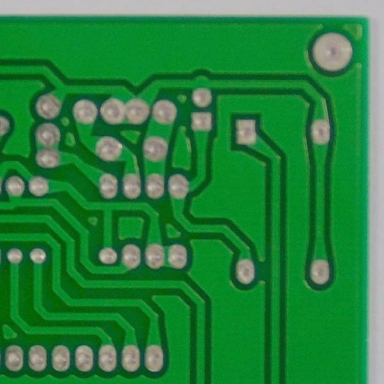
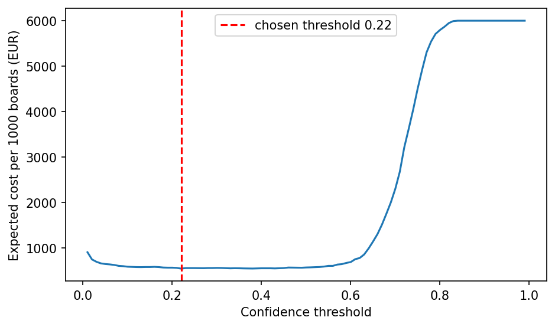

# Assignment 2 Report

_Delete this italic guidance as you fill in each section. You'll be asked to
defend any of this without your code in front of you. Write only what you
can actually explain._

- **Name**: Armand Hubler
- **Student ID**: 19095
- **Email**: ahubler.ieu2022@student.ie.edu
- **Group**: BBADBA 5A

## Business problem, and the cost of being wrong

Printed circuit board (PCB) producers need to run quality checks on every unit produced. This check leads to 2 possible outcomes: ship the board to assembly, or fail it (send it back or scrap it).
Since this check can be very meticulous, a vision model was trained to detect defects upstream and reduce the time needed for human verification. Human inspectors make errors, are costly and are overall not efficient. In this context, a type II error (shipping a board that has a defect) has a higher impact, since these boards are assembled or shipped to customers, which could impact brand reputation. On the other hand, a type I error (failing a working board) costs money since the board could have been sold. Moreover, type I errors are less critical since the board would be sent for human inspection and would most likely get approved. We can assert with confidence that the error asymmetry leans in favor of reducing type II errors (missed defects) over type I errors (false alarms). Assuming a missed defect costs €200 and a false alarm €2, a missed defect is roughly 100 times more expensive. This ratio follows the "rule of ten" in electronics manufacturing ([Anitha & Rao, 2019](https://smtnet.com/library/files/upload/F8739088619.pdf)).
Since we want to minimize type II errors, recall (the share of defects caught) is naturally the metric to monitor. We would most likely adopt a low threshold due to the cost asymmetry (failing is cheaper). We can assume that checking one flagged board takes around 1.5 minutes, since the model shows where the defect is, and that an inspector spends around 7 hours a day checking boards. One inspector can therefore check around 7 × 60 / 1.5 = 280 boards a day, and the number of inspectors can be expressed as I = (N × r) / 280, where N is the number of boards produced per day and r the share of boards sent for human review.

## Dataset

I used the PCB defect dataset from Roboflow Universe:

- workspace `ai-dyci3`
- project `pcb-defect-eosje`
- version 2 ([link](https://universe.roboflow.com/ai-dyci3/pcb-defect-eosje/dataset/2)).
  It is built from the PKU-Market-PCB dataset published by Peking University, which contains high resolution photos of 10 bare board designs with synthesized defects ([Huang & Wei, 2019](https://arxiv.org/abs/1901.08204)).
  One image is a 600×600 crop of a top-down photo of a PCB with only copper tracks, pads and holes, but no components, resized to 640×640. Roboflow created around 14 images from each photo with some augmentation (crops, variants, etc). Therefore, one image is only a part of a board, but to keep the cost model simple, we treat one image as one board in the rest of this report.

The dataset has 6 classes, which are the most common defects on a bare board:

- missing hole: a drill hole is missing
- mouse bite: a small piece of copper is missing on the edge of a track
- open circuit: a track is cut
- short: copper connects two tracks that should be separated
- spur: a small piece of copper sticks out of a track
- spurious copper: copper appears where there should be none

This dataset serves our problem since it shows what an inspection camera sees at the end of the bare board production line, before the components are assembled.
Moreover, each class can be linked to a step of the process (missing hole comes from drilling, open circuit and mouse bite from too much etching, short, spur and spurious copper from too little etching), so the class can help engineers find where the problem comes from. The defects are also labelled with boxes, so the model can show the inspector where to look.

## What the dataset's composition implies

The dataset has 9,744 images and 19,847 defects (around 2 defects per image), and every image contains at least one defect. The classes are balanced:

| Class           | Train | Valid | Test | Median box size (share of the image side) |
| --------------- | ----- | ----- | ---- | ----------------------------------------- |
| missing hole    | 2,327 | 477   | 556  | 4.6%                                      |
| mouse bite      | 2,377 | 476   | 502  | 4.3%                                      |
| open circuit    | 2,234 | 455   | 467  | 3.5%                                      |
| short           | 2,288 | 473   | 428  | 5.7%                                      |
| spur            | 2,322 | 573   | 483  | 5.0%                                      |
| spurious copper | 2,370 | 518   | 521  | 5.1%                                      |

The defects are small such that the median box side is between 3.5% and 5.7% of the image side, which is around 22 to 36 pixels in a 640 pixel image. Therefore, we kept the full image size (640) for training.

However, during the initial analysis, I have identified an issue in the split. Roboflow split the images randomly, so the crops, rotations and lighting variants of the same photo ended up in both train and test. In practice, 99.9% of the test images came from a photo that was also in train. The test score would then measure how well the model remembers a photo, not how well it inspects a new board.
Therefore, I decided to split the data again by photo (70% / 15% / 15%, with the same shares for each class), so all the images of a photo stay in the same split. I ended up with 6,847 / 1,450 / 1,447 images, coming from 482 / 102 / 107 photos.

The test split has around 500 defects per class, but they come from only around 18 photos per class, and the images of a same photo are very similar. In practice, the model's mistakes come from only 30 of the 107 test photos. Therefore, we have much less data than it looks.
Moreover, the test split does not fully look like production. The dataset also has no defect-free boards, and the photos were taken in a lab.

Therefore, we cannot conclude:

- how often the model raises a false alarm on a defect-free board
- how the model performs on real production images
- what the real share of defective boards is (we have to assume it)

## Finetuning and baselines

The model relies on detection but the infered probability helps us to also apply classification on defects. The defects are very small (around 0.2% of the image area) and one image can contain up to 5 defects, so a classifier would struggle to find them.
Moreover, a detection model shows where the defect is, which makes the human check faster. To take a decision for a board, we use the confidence of the most confident box on the board, which we call the board score.
I finetuned `yolo11n`, which is the smallest YOLO model pretrained on COCO, since it is fast enough to run on a production line without a large GPU. I trained it on Google Colab (Tesla T4 GPU) for 50 epochs, with an image size of 640, a batch size of 16, the default Ultralytics augmentations and a seed of 0. Screenshots of the training can be find in this repository. Training took around 80 minutes. The validation mAP50 reached 0.95 after 10 epochs and stopped improving around epoch 30 (0.98), so more epochs would not help.

I compared it on the same test split with two baselines:

- the pretrained COCO model using zero-shot. Since COCO has no PCB defect class, we ignore the class it predicts and count a box as correct as long as it lands on a defect.
- a trivial baseline that predicts nothing, so every board is shipped (no inspection).

For each model, we use the threshold with the lowest cost.

| Model                  | AP50 (any defect) | Threshold | Defective boards caught | False alarm rate | Cost per 1,000 boards |
| ---------------------- | ----------------- | --------- | ----------------------- | ---------------- | --------------------- |
| Finetuned yolo11n      | 0.964             | 0.22      | 98.8%                   | 8.6%             | €538                  |
| COCO yolo11n zero-shot | 0.00005           | 0.75      | 0%                      | 0%               | €6,000                |
| Predict nothing        | 0                 | –         | 0%                      | 0%               | €6,000                |

With the classes, the finetuned model reaches a mAP50 of 0.963 and a mAP50-95 of 0.465 on the test split.

The COCO model performs like the trivial baseline. Its best threshold is the one where it never flags a board. This was expected, since COCO contains objects like people or cars, not copper defects. All the value therefore comes from the finetuning, which reduces the cost from €6,000 to €538 per 1,000 boards. A perfect model would still cost €300 (repairing the 30 defective boards), so our model captures around 96% of the possible saving. It is important to note that a mAP50 of 0.96 is probably higher than what we would get in production, since the test boards share their designs with train.
Finally, the gap between mAP50 (0.963) and mAP50-95 (0.465) shows that the model finds the defects but draws loose boxes. On a 30 pixel defect, a few pixels of error is enough to fail the stricter overlap. This is not an issue for our decision, since we only need to know if there is a defect and roughly where.

## Per-class evaluation and failure modes

We treat a defect (any of the 6 classes) as the positive class. The table below shows the results per class on the test split (precision and recall at the threshold chosen by Ultralytics to balance the two).

| Class           | Precision | Recall | AP50  | mAP50-95 |
| --------------- | --------- | ------ | ----- | -------- |
| missing hole    | 0.993     | 0.983  | 0.984 | 0.533    |
| spurious copper | 0.928     | 0.969  | 0.979 | 0.465    |
| open circuit    | 0.980     | 0.935  | 0.967 | 0.443    |
| spur            | 0.949     | 0.944  | 0.954 | 0.467    |
| mouse bite      | 0.941     | 0.948  | 0.950 | 0.439    |
| short           | 0.945     | 0.931  | 0.945 | 0.445    |

Missing hole has the best precision, recall, AP50 and mAP50-95. This makes sense since a missing hole has high contrast, which is easy to recognise. Short, mouse bite and spur are the weakest classes (AP50 around 0.95). These are thin and irregular defects along the tracks. However, since we have much less data than it looks, differences of 1 to 3 points between classes are not reliable, and only the lead of missing hole is clear.

The confusion matrix at a threshold of 0.22 shows that the model rarely confuses two defects:

|                                  | missing hole | mouse bite | open circuit | short | spur | spurious copper |
| -------------------------------- | ------------ | ---------- | ------------ | ----- | ---- | --------------- |
| Correct                          | 547          | 482        | 450          | 406   | 463  | 517             |
| Missed (predicted as background) | 9            | 17         | 11           | 21    | 20   | 4               |
| False boxes on clean copper      | 5            | 33         | 12           | 22    | 41   | 60              |

Only 10 of the 2,957 test defects get the wrong class, mostly open circuits predicted as mouse bites. These defects look alike, since an open circuit is a mouse bite that cuts the full track. Most errors are therefore between a defect and the background (82 missed defects and 173 boxes on clean copper). Spurious copper raises the most false alarms (60) but misses almost nothing (4).

When looking at where the model fails, we found 3 main issues:

- Defects on the edge of the image. 59% of the missed defects are close to the image border, while only 16% of all defects are. In the example below, the missing hole is cut by the left border of the crop. This comes from the way the photos were cropped, not from the model itself.
- Some board designs. The false alarm rate reaches 23.6% on design 06, against 0% on designs 04 and 10. A new board design is therefore a real risk.
- Confident false alarms. The worst false alarms get the same score as real defects (around 0.75), so no threshold can separate them. This is why some boards need a human check.

On the other hand, the size of the defect and the lighting or rotation variants have almost no impact on the results.

## Cost matrix and operating point

We assign the following costs to each outcome, per board:

| Outcome                            | Cost | Source                                                                                                                           |
| ---------------------------------- | ---- | -------------------------------------------------------------------------------------------------------------------------------- |
| Missed defect (false negative)     | €200 | Rule of ten: 100× the bare board at system level ([Anitha & Rao, 2019](https://smtnet.com/library/files/upload/F8739088619.pdf)) |
| False alarm (false positive)       | €2   | Around 3.5 min of a technician checking the board                                                                                |
| Caught defect (true positive)      | €10  | Around 15–20 min of repair                                                                                                       |
| Good board shipped (true negative) | €0   | Normal flow                                                                                                                      |

We assume that 3% of the boards have a defect, since the dataset cannot give us this number (every image has a defect).

To compute the cost, we give each test board a score: the best box on a real defect for a defective board, and the best box on clean copper for a clean board (since the dataset has no defect-free boards). We then scale the results to 1,000 boards and compute the cost for every threshold between 0.01 and 0.99.

The lowest cost is at a threshold of 0.22, with €538 per 1,000 boards. At this threshold, the model catches 98.8% of the defective boards and raises a false alarm on 8.6% of the good boards. The curve is flat between 0.22 and 0.5, but the cost increases very fast after 0.6, since most real defects get a score around 0.7. It is therefore safer to choose a threshold that is too low than too high.

The assumption that would most change our answer is the share of defective boards. With 1% instead of 3%, the best threshold would move from 0.22 to 0.43.

## What a person still has to check

We use two thresholds: boards with a score below 0.22 are shipped, boards between 0.22 and 0.76 are sent to an inspector, and boards from 0.76 are failed automatically. We found them by testing every pair of thresholds and keeping the cheapest one, including the time of the inspectors.
With these thresholds, 10.7% of the boards are sent to a person. Assuming a line producing 2,000 boards a day, this is around 214 boards a day. With the formula from the business section (1.5 minutes per board, so 280 boards per inspector), we need I = (2,000 × 0.107) / 280 ≈ 0.76 inspector. This is realistic: one inspector is enough. However, only around 22% of the boards an inspector sees are really defective, so there is a risk that the inspector gets used to approving boards and starts missing real defects.

We compare our design with the three alternatives, with an inspector cost of €30/h:

| Strategy                          | Cost per 1,000 boards | Cost per day | Inspectors needed | Missed defects per day | Good boards failed per day |
| --------------------------------- | --------------------- | ------------ | ----------------- | ---------------------- | -------------------------- |
| Do nothing (ship every board)     | €6,000                | €12,000      | 0                 | 60                     | 0                          |
| A person checks every board       | €1,050                | €2,100       | 7.1               | 0 (perfect inspector)  | 0                          |
| Model alone (threshold 0.22)      | €538                  | €1,077       | 0                 | 0.75                   | 168                        |
| Model and inspector (0.22 / 0.76) | €453                  | €905         | 0.76              | 0.75                   | 1.3                        |

Our design is the cheapest. Compared to the model alone, it saves around €170 a day, mainly because the inspector stops good boards from being failed (from 168 to around 1 a day). Compared to checking every board, it saves around €1,200 a day and needs 6 fewer people.
However, these numbers assume that the inspector never makes a mistake. If the inspector misses more than 2% of the real defects, our design becomes more expensive than the model alone.

## Limitations & next steps

- No defect-free boards. The false alarm rate is measured on the background of defective boards. We would run the model on photos of defect-free boards (or on one day of production) to measure the real false alarm rate, on full boards rather than crops.
- Same board designs in train and test. We would test the model on a design it has never seen, by training on 9 designs and testing on the last one.
- Small number of test photos. The test split has only 107 photos, so we would collect more different photos rather than more crops of the same ones.
- Defects on the edge of the image. We would cut the board into crops that overlap, so each defect is fully visible in at least one crop.
- Lab images with synthesized defects. We would run the model next to the current inspection for a few weeks, without acting on its decisions, and compare the results.
- Same cost and threshold for every class. A short is more dangerous than a small spur, so we would use a cost and a threshold per class.
- Threshold chosen on the test split. We would choose the thresholds on the validation split and only use the test split to report the final cost.
- Perfect inspector assumption. We would measure the accuracy of the inspectors and add it to the cost model.
- Small model. We would try `yolo11s` and a larger image size, as long as it stays fast enough for the line.
- Assumed costs and volumes. We would replace the costs, the 3% defect rate and the 2,000 boards a day with real data from the production and finance teams.

## Generative AI use disclosure

AI was used to build the data pipeline and to sanity check the data once it was downloaded.
AI flagged that very similar images of the same board appeared in both train and test, which led to a clean split by photo in the final iteration.
AI was used to build the dashboard.
AI was also used for the overall formatting and a final sanity check of the report.
